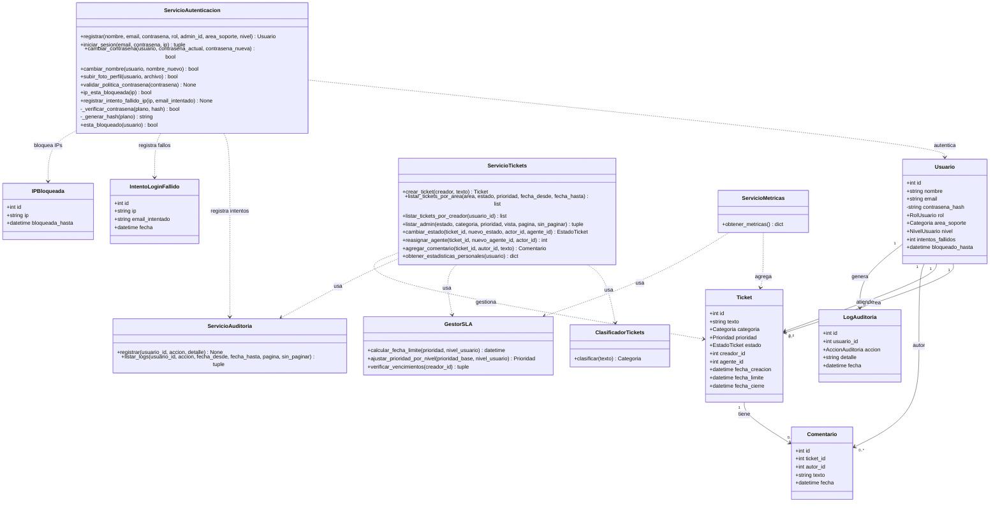
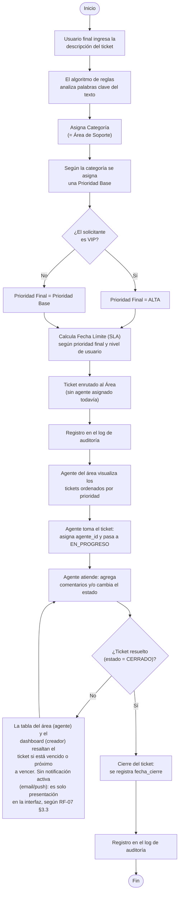

# Avances de arquitectura

## Stack tecnológico

| Componente | Tecnología | Justificación |
|---|---|---|
| Backend | Python + Flask | Framework simple, sin sobre-ingeniería, adecuado para el tamaño del equipo y el tiempo disponible. |
| Base de datos | SQLite | Cero configuración de servidor, suficiente para el volumen de datos del proyecto. |
| ORM | SQLAlchemy (Flask-SQLAlchemy) | Evita escribir SQL a mano para las operaciones básicas y mantiene el modelo de datos como código Python. |
| Frontend | HTML/CSS + plantillas Jinja2 (Bootstrap 5 vía CDN) | Sin framework de frontend adicional, evitando complejidad innecesaria. |
| Control de versiones | Git + GitHub | Historial de commits como evidencia de aporte individual de cada integrante del equipo. |
| Seguridad | Flask-WTF (CSRF), bcrypt (hash de contraseñas) | Protección contra CSRF en formularios y almacenamiento seguro de contraseñas. |
| Tareas en segundo plano | APScheduler | Limpieza periódica de registros de intentos de login fallidos, sin depender de un cron externo del sistema operativo. |
| Manejo de imágenes | Pillow | Validación de que un archivo subido como foto de perfil es realmente una imagen válida, no solo su extensión. |
| Exportación de datos | openpyxl + módulo `csv` estándar | Generación de reportes en Excel y CSV desde tickets, métricas y auditoría. |
| Pruebas | pytest | Suite de pruebas automatizadas con fixtures, reemplazando los scripts manuales iniciales. |
| Integración continua | GitHub Actions | Ejecuta la suite de pytest automáticamente en cada push/PR hacia `main`. |
| API REST | Blueprint de Flask con respuestas JSON y tokens personales | Permite integrar el sistema con scripts y herramientas externas reutilizando los mismos servicios y permisos que la interfaz web. |
| Gráficas | Chart.js (CDN) | Visualización del volumen diario y de pendientes en la página de analítica. |

## Modelo de datos

| Entidad | Campos principales |
|---|---|
| **Usuario** | id, nombre, email, contrasena_hash, rol (final/agente/admin), area_soporte (solo aplica si es agente; se guarda como `Categoria`), nivel (normal/VIP), intentos_fallidos, bloqueado_hasta, activo, ultimo_acceso, ausente_desde, ausente_hasta, motivo_ausencia |
| **Ticket** | id, texto, categoria, prioridad, estado, creador_id, agente_id, fecha_asignacion, fecha_creacion, fecha_limite, fecha_cierre, notificado_proximo_vencer, notificado_vencido, notificado_sin_asignar, clasificacion_baja_confianza |
| **Comentario** | id, ticket_id, autor_id, texto, fecha |
| **LogAuditoria** | id, usuario_id, accion (enum `AccionAuditoria`), detalle, fecha |
| **IntentoLoginFallido** | id, ip, email_intentado, fecha — registra cada fallo de login (exista o no ese usuario), fuente para la detección de bloqueo por IP |
| **IPBloqueada** | id, ip (único), bloqueada_hasta — bloqueo activo de una IP, generado cuando 5 emails distintos fallan desde la misma IP en 1 hora |
| **DobleFactor** | id, usuario_id (único), secreto, activo, codigos_respaldo (hash), ultimo_paso, intentos_fallidos, bloqueado_hasta — configuración de la verificación en dos pasos |
| **TokenRecuperacion** | id, usuario_id, token_hash (único), fecha_creacion, expira, usado — enlaces de recuperación de contraseña |
| **Articulo** | id, titulo, resumen, contenido, categoria, etiquetas, publicado, autor_id, fechas, vistas, votos_utiles, votos_no_utiles, resoluciones — base de conocimiento |
| **VotoArticulo** | id, articulo_id, usuario_id, util — un voto por usuario y artículo |
| **Adjunto** | id, ticket_id, comentario_id, usuario_id, nombre_original, nombre_guardado (único), tipo_mime, tamano, fecha |
| **RespuestaPredefinida** | id, titulo, contenido, categoria, compartida, autor_id, usos, fecha_creacion |
| **SeguidorTicket** | id, ticket_id, usuario_id (pareja única) |
| **EncuestaSatisfaccion** | id, ticket_id (único), usuario_id, agente_id, puntuacion (1–5), comentario, fecha |
| **TokenApi** | id, usuario_id, nombre, prefijo, token_hash (único), fecha_creacion, expira, ultimo_uso, revocado |

En la versión 3.0 `Usuario` incorpora `activo` y `ultimo_acceso`, y `Comentario` incorpora
`interno`. `init_db.py` agrega estas columnas a una base existente sin perder datos
(`app/migraciones.py`).

**Nota:** el campo `radicado` que existía en versiones anteriores del modelo `Ticket` se
eliminó en la versión 1.2 — ver `07_avances.md`.

## Separación de responsabilidades

Siguiendo el principio de responsabilidad única, la lógica de negocio se separa de las
entidades de datos en clases de servicio independientes:

| Clase de servicio | Responsabilidad |
|---|---|
| `ServicioAutenticacion` | Registro de usuarios (`registrar`, requiere `rol` y `admin_id`), verificación de credenciales (`iniciar_sesion`), generación/verificación de hash de contraseña, control de bloqueo por intentos fallidos por usuario y por IP (`ip_esta_bloqueada`, `registrar_intento_fallido_ip`), política de contraseñas (`validar_politica_contrasena`), y autoservicio de perfil (`cambiar_contrasena`, `cambiar_nombre`, `subir_foto_perfil`). Única clase autorizada a manejar contraseñas en texto plano. |
| `ClasificadorTickets` | Determina únicamente la **categoría** de un ticket a partir de su texto, por coincidencia de palabras clave. No calcula prioridad. |
| `ServicioTickets` | Orquesta el ciclo de vida completo del ticket: crear (aplica clasificación, prioridad base, ajuste VIP y SLA), listar por área con filtros, listar por creador, listar globalmente para el administrador con filtros y vistas especiales de SLA (`listar_admin`), cambiar estado (valida transiciones), reasignar agente, agregar comentarios y calcular estadísticas personales de un usuario (`obtener_estadisticas_personales`). |
| `GestorSLA` | Calcula la fecha límite de atención según la prioridad final **y el nivel del usuario**, ajusta la prioridad por nivel VIP, y verifica qué tickets están vencidos o próximos a vencer — opcionalmente filtrado por creador. Mide el consumo de SLA de un ticket (`consumo_sla`), ordena la cola por riesgo (`clave_riesgo`), reparte el aviso de un ticket sin dueño entre los agentes disponibles del área o lo escala al administrador si el área no tiene cobertura (`_avisar_area`), y escala al administrador los tickets que envejecen sin asignar (`escalar_tickets_sin_asignar`). |
| `ServicioAuditoria` | Registra cada acción crítica en `LogAuditoria`, con un reintento automático si el primer guardado falla, y permite consultarlo con filtros y paginación (`listar_logs`). |
| `ServicioMetricas` | Calcula los conteos agregados que alimenta el panel del administrador (tickets por estado/categoría/prioridad, vencidos, próximos a vencer, vencidos últimos 30 días, cantidad de agentes). |
| `ServicioPermisos` | Decide quién puede ver un ticket, ver notas internas y gestionarlo. Lo usan las rutas web, las descargas de adjuntos y la API. |
| `ServicioUsuarios` | Gestión administrativa de cuentas: listado con filtros, edición de rol/área/nivel, activación y desactivación, desbloqueo, envío de recuperación y restablecimiento de la verificación en dos pasos, con salvaguardas (no quitarse el propio rol, conservar un administrador activo, no mover agentes con tickets en curso). |
| `ServicioBaseConocimiento` | Artículos de ayuda: creación, edición, publicación, búsqueda, votos y sugerencias por reglas (coincidencia de términos normalizados en título, etiquetas, resumen y contenido, con bonificación por la categoría que estima `ClasificadorTickets`). |
| `ServicioAdjuntos` | Valida y guarda archivos (lista blanca de extensiones, firma del contenido, tamaño y cantidad máximos) fuera de la carpeta pública. |
| `ServicioSeguimiento` | Seguidores de tickets; reciben notificaciones de comentarios y cambios de estado. |
| `ServicioRespuestasPredefinidas` | Plantillas de respuesta privadas o compartidas, con variables y contador de usos. |
| `ServicioEncuestas` | Encuesta de satisfacción al cierre (una por ticket, solo el creador, 14 días de plazo) y resúmenes de CSAT. |
| `ServicioAnalitica` | Indicadores por periodo y su variación contra el periodo anterior: volumen diario, pendientes, primera respuesta, tiempo de resolución, cumplimiento de SLA por categoría, mapa de calor por día y hora, ranking de agentes y uso de la base de conocimiento. |
| `ServicioTokensApi` | Tokens personales de la API (guardados como hash SHA-256, con caducidad y revocación) y límite de peticiones por minuto. |
| `ServicioDisponibilidad` | Disponibilidad declarada de los agentes. Guarda la ausencia como una ventana de fechas en el propio usuario (`ausente_desde` / `ausente_hasta`) y deriva de ella la disponibilidad, tanto en Python (`esta_disponible`) como en SQL (`filtro_disponible`), para no tener dos fuentes de verdad. Expone además los agentes disponibles de un área, los conteos de cobertura y la lista de ausentes. |

## Diagrama de clases

## Diagrama de flujo

## Responsabilidad de área y modelo de autoservicio (v3.1)

El sistema no asigna tickets automáticamente: un ticket nuevo queda sin agente y
es un agente del área quien lo toma (modelo *pull*). La asignación automática se
descartó porque puede sobrecargar a un agente o asignarle trabajo a alguien que
no está. El riesgo de ese modelo es el contrario: que nadie tome el ticket y el
plazo se consuma sin que nadie se entere. Esta versión agrega los controles que
cierran ese hueco sin quitarle al agente la decisión de qué atender:

1. **Disponibilidad declarada.** La ausencia es una ventana de fechas en el
   usuario. Un agente ausente sale de las sugerencias, de los destinos de
   transferencia y del conteo de cobertura del área. Sus tickets ya asignados no
   se tocan: reasignarlos es una decisión del administrador, no del sistema.
2. **El aviso de SLA tiene dueño.** Si el ticket no tiene agente, el aviso de
   "próximo a vencer" o "vencido" va a los agentes activos y disponibles del
   área. Si el área se quedó sin nadie disponible, sube al administrador. Antes
   ese aviso solo llegaba al agente asignado, así que un ticket sin dueño no le
   llegaba a nadie del equipo de soporte.
3. **La cola no esconde lo urgente.** La vista del área se ordena por porcentaje
   de SLA consumido, no solo por prioridad. Un ticket de prioridad media que
   vence en diez minutos aparece antes que uno alto que acaba de entrar. El
   agente sigue eligiendo.
4. **Edad sin asignar como métrica.** Al pasar `UMBRAL_SIN_ASIGNAR` (50 %) del
   plazo sin agente, el ticket se escala una sola vez al administrador. Ahí sí
   hace falta intervención humana.
5. **Vista de huecos.** `/admin/cobertura` muestra los tickets sin asignar
   ordenados por riesgo y la cobertura de cada área.

La deduplicación de los avisos usa banderas en el ticket, igual que las dos que
ya existían: `notificado_sin_asignar` se marca al escalar y se rearma cuando el
ticket vuelve a tener agente (o cuando un escalamiento de área aprobado lo deja
otra vez sin dueño).

El escalamiento automático no deja registro en `LogAuditoria` porque
`LogAuditoria.usuario_id` es obligatorio y un trabajo del *scheduler* no tiene un
actor humano al que atribuirlo; la notificación al administrador es el registro.
Marcar y levantar una ausencia sí se auditan (`marcar_ausente`,
`marcar_disponible`), porque son acciones de una persona.

## Pausa de SLA, cobertura de ausencias y webhooks (v3.5)

Esta versión ataca tres huecos distintos: el tiempo que soporte no controla, el
trabajo que queda en manos de alguien que no está, y la falta de salida hacia
otros sistemas.

### El reloj de SLA se puede detener

Hasta la 3.1 el plazo de un ticket corría desde que se creó hasta su fecha
límite, sin importar de quién dependiera avanzar. Eso castiga al agente por un
tiempo que no es suyo: si falta un dato del solicitante, el ticket se vence
mientras nadie en soporte puede hacer nada.

El estado `EN_ESPERA` resuelve eso con dos campos en el ticket y ningún booleano
aparte:

- `sla_pausado_desde`: inicio de la pausa en curso (nulo si el reloj corre).
- `sla_segundos_pausados`: suma de las pausas ya aplicadas a `fecha_limite`.

Al entrar en espera solo se marca el inicio. Al salir —hacia `EN_PROGRESO` o
hacia `CERRADO`— se acumula la duración, se corre `fecha_limite` ese mismo
tiempo y se vuelven a armar las banderas de aviso de SLA, porque el plazo se
movió y de lo contrario un ticket que ya había avisado de vencido no volvería a
avisar nunca.

`consumo_sla` descuenta del plazo total las pausas ya aplicadas y del tiempo
transcurrido todas las pausas, incluida la que esté en curso. El resultado es
que el porcentaje consumido se **congela** durante la espera, que es lo que hace
que la cola ordenada por riesgo no mienta. `verificar_vencimientos` excluye los
tickets en espera: un ticket pausado no vence.

Dos reglas de producto sostienen el diseño:

1. **La espera exige motivo** (`MotivoRequeridoError`). Pausar el reloj sin
   escribir qué se está esperando sería la forma más fácil de esconder un ticket
   que se está venciendo. El motivo se guarda además como comentario público.
2. **La reanudación no es manual.** Cuando el solicitante responde en la
   conversación, `agregar_comentario` reanuda el ticket
   (`ServicioTickets.reanudar_por_respuesta`). Si hubiera que reanudarlo a mano,
   el reloj seguiría detenido mientras la respuesta ya está esperando al agente.
   Una nota interna o un comentario del propio agente no reanudan nada.

### Los tickets de un agente ausente tienen a quién avisarle

La 3.1 sacó al agente ausente de las sugerencias, pero dejó documentado el hueco
contrario: los tickets que **ya** tenía asignados seguían avisándole solo a él.
La 3.5 lo cierra con la columna `tickets.requiere_cobertura`:

- `ServicioDisponibilidad.marcar_tickets_para_cobertura` marca los tickets vivos
  del agente al activarse la ausencia (una ausencia programada a futuro no marca
  nada todavía) y avisa a los agentes disponibles del área del ticket, o al
  administrador si el área se quedó sin nadie.
- `GestorSLA._avisar_agente_o_area` avisa al agente asignado y, si ese agente
  está ausente o inactivo, avisa también al área y marca el ticket. Así el caso
  queda cubierto incluso cuando la ausencia se activa por fecha y nadie llamó a
  `marcar_ausente` en ese momento.
- `ServicioTickets.tomar_cobertura` permite que un agente disponible del área, o
  el administrador, se quede con el ticket sin pasar por una solicitud de
  transferencia, que requeriría la aceptación del agente ausente.
- Al volver el agente, `limpiar_cobertura_del_agente` quita la marca.

El sistema sigue sin reasignar por su cuenta: marca, avisa y deja que una
persona decida, igual que el resto del modelo *pull*.

### Webhooks: el problema no es enviar, es que el receptor pueda creer

Un webhook apunta a una URL normalmente pública: cualquiera podría enviarle un
POST diciendo que un ticket crítico se cerró. Por eso cada envío va firmado:

    X-Tickets-Signature: t=<marca de tiempo>,v1=<HMAC-SHA256 de "marca.cuerpo">

La marca de tiempo va **dentro** de la firma, no al lado, para que una copia
capturada no se pueda reenviar más tarde (*replay*); el receptor la valida con
una tolerancia de 5 minutos. El secreto se guarda en claro a propósito: a
diferencia de una contraseña o de un token de API, aquí el sistema necesita el
valor original para poder firmar.

Otras decisiones:

- **La emisión no interrumpe el dominio.** `emitir` empieza por la consulta más
  barata posible y, si no hay ningún webhook suscrito a ese evento, no construye
  payload ni lanza hilo. En una instalación sin webhooks el costo es una
  consulta.
- **Reintentos solo de lo transitorio.** Sin respuesta o 5xx se reintenta (hasta
  3 veces); un 4xx significa que el receptor rechazó el mensaje y repetirlo no lo
  cambia.
- **Auto-desactivación.** Tras 10 fallos seguidos el webhook se apaga solo, para
  no gastar hilos y timeouts en una URL que ya no existe. Queda en auditoría.
- **Validación de destino (SSRF).** Un webhook es una petición que hace el
  servidor a donde le digan. Sin validar, quien pueda crear uno usaría el
  servidor para alcanzar servicios de la red interna que desde fuera no son
  visibles. Se aceptan solo `http`/`https` y se rechazan `localhost`, las
  direcciones de bucle y los rangos privados, salvo que la instalación habilite
  `WEBHOOKS_PERMITIR_DESTINOS_LOCALES`.
- **La bitácora no crece sin fin:** se conservan las últimas 50 entregas por
  webhook.

### Búsqueda global

`ServicioBusqueda` busca en tickets, artículos y usuarios. El criterio de diseño
es el acceso: los tickets se filtran con `ServicioPermisos.puede_ver_ticket`, los
borradores de la base de conocimiento solo los ve el personal y las cuentas solo
el administrador. Un título visible en los resultados ya es información
filtrada, aunque el enlace diera 403. Los comodines `%` y `_` que escriba el
usuario se escapan para que no traigan la tabla completa, y un número suelto se
acepta como búsqueda por número de ticket.

## Estado actual de la implementación

- [x] Modelos de datos (`Usuario`, `Ticket`, `Comentario`, `LogAuditoria`) implementados y
      verificados contra la base de datos real.
- [x] `create_app()`, `init_db.py` y conexión de la base de datos funcionando.
- [x] `ServicioAutenticacion`: generación/verificación de hash de contraseña (bcrypt), registro
      completo de usuarios y control de bloqueo por intentos fallidos.
- [x] `ClasificadorTickets` y `ServicioTickets` (creación, cambio de estado, reasignación,
      comentarios).
- [x] `GestorSLA` (cálculo de fecha límite por prioridad y nivel, verificación de vencimientos).
- [x] `ServicioAuditoria` integrado al flujo de la aplicación (login, registro, tickets,
      comentarios, bloqueos).
- [x] `ServicioMetricas` y panel de métricas para el administrador (`/dashboard`).
- [x] Interfaz web completa (login, registro, crear ticket, listar por área, detalle de
      ticket, dashboard, panel de métricas, auditoría, perfil, listado admin global).
- [x] Pantalla para que el administrador consulte el log de auditoría, con filtros,
      paginación y exportación a CSV/Excel (RF-10 / CU-06).
- [x] Recordatorio de SLA visible tanto para el agente como para el creador del ticket
      (RF-07).
- [x] Renombrado `app/Templates/` → `app/templates/` y `app/Static/` → `app/static/`.
- [x] Autoservicio de perfil: cambio de contraseña, cambio de nombre, foto de perfil,
      estadísticas personales/de agente (CU-08).
- [x] Filtros (estado, prioridad, fecha) en el listado por área, y listado administrativo
      global con las mismas capacidades más vistas especiales de SLA (CU-04, CU-09).
- [x] Eliminación del campo `radicado` del modelo `Ticket`.
- [x] Seguridad: CSRF en los 6 formularios, política de contraseñas, bloqueo por usuario
      (3 intentos/5h) y por IP (5 emails distintos/1h → 3h, con limpieza automática cada
      90 min vía `APScheduler`) (CU-10).
- [x] Drill-down de métricas y exportación a CSV/Excel de tickets, métricas y auditoría.
- [x] Rediseño visual completo de la interfaz.
- [x] Suite de pruebas migrada a `pytest` con fixtures (`tests/conftest.py`), corriendo
      automáticamente en cada push/PR vía GitHub Actions (`.github/workflows/tests.yml`).
- [x] Verificación en dos pasos (TOTP) y recuperación de contraseña por correo.
- [x] Versión 3.0: base de conocimiento con sugerencias al crear tickets, adjuntos, notas
      internas, respuestas rápidas, seguidores, encuesta de satisfacción, analítica,
      gestión de usuarios, API REST con tokens, control de acceso por ticket y
      actualización de esquema sin pérdida de datos.
